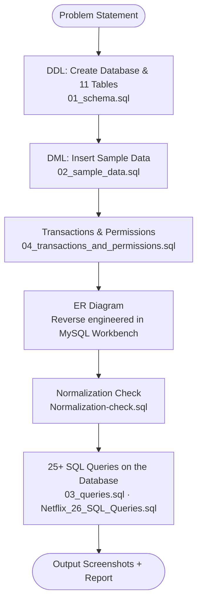
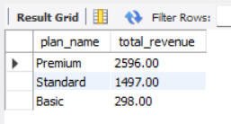
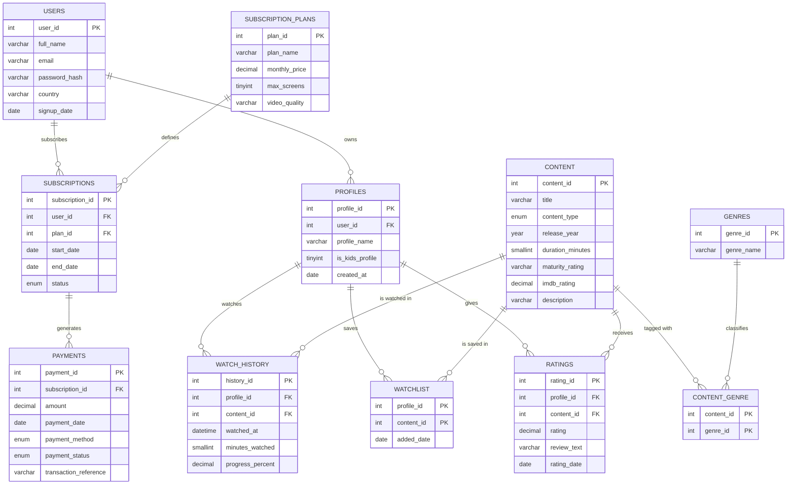

# 🎬 Entertainment and Streaming Management System

**DBMS Course Project · Entertainment & Streaming Platform · MySQL 8.0+**

> This README gives a quick overview of the project and where everything is. Detailed explanations are in the project report.

---

## 📑 Index

1. [Problem Statement & Objective](#1-problem-statement--objective)
2. [Project Workflow](#2-project-workflow)
3. [DDL, DML & Queries](#3-ddl-dml--queries)
4. [Output](#4-output)
5. [ER Diagram](#5-er-diagram)
6. [Normalization](#6-normalization)
7. [How to Run](#7-how-to-run)
8. [Research Sources](#8-research-sources)

---

## 1. Problem Statement & Objective

**Problem:** A streaming platform has millions of users and thousands of titles. Without a well-structured database, it cannot answer basic questions such as *which plan a user is on, what a profile watched, which genre is most popular, or how much revenue each plan earns.*

**Objective:** Design and implement a relational database for a Netflix-style streaming platform that stores users, subscriptions, payments, profiles, content, genres, watch history, ratings and watchlists, and prove it works by running SQL queries on it.

---

## 2. Project Workflow



**Database at a glance:** 11 tables

`users` · `subscription_plans` · `subscriptions` · `payments` · `profiles` · `content` · `genres` · `content_genre` · `watch_history` · `ratings` · `watchlist`

---

## 3. DDL, DML & Queries

All code is in [`SQL_Files/`](./SQL_Files) and runs directly in MySQL Workbench.

| File | Type | What it does |
|---|:---:|---|
| `01_schema.sql` | DDL | Creates the database `netflix_streaming_db` and all 11 tables with primary keys, foreign keys and constraints |
| `02_sample_data.sql` | DML | Inserts sample data into all tables |
| `03_queries.sql` | DQL | 25 SQL queries: joins, subqueries, aggregate functions, `GROUP BY`, `HAVING` |
| `04_transactions_and_permissions.sql` | TCL / DCL | `COMMIT`, `ROLLBACK`, `SAVEPOINT`, `GRANT`, `REVOKE` |
| `Netflix_26_SQL_Queries.sql` | DQL | Final query set used to test the database and capture the output screenshots |
| `Normalization-check.sql` | DQL | Reads table, column and key details from `INFORMATION_SCHEMA` to check the design |

Examples of what the queries answer: revenue per subscription plan, average rating per genre, most-watched titles, watch time per profile, payments by method, and the latest subscription per user.

---

## 4. Output

Screenshots of every result are in [`Output_Screenshots/`](./Output_Screenshots).

| Files | Contents |
|---|---|
| `query1.png` – `query25.png` | Result grid of each query, numbered in order |
| `Norm_Output1.png`, `Norm_Output2.png` | Results of `Normalization-check.sql` |

**Sample output: Revenue per plan**



---

## 5. ER Diagram



The MySQL Workbench version of this diagram is in the [`ER_Diagrams/`](./ER_Diagrams) folder.

---

## 6. Normalization

| Normal Form | How the schema satisfies it |
|:---:|---|
| **1NF** | Every column holds a single value; a user's multiple profiles are stored as rows in `profiles`, and a title's multiple genres as rows in `content_genre`, never as lists in one cell |
| **2NF** | No partial dependencies; in the composite-key tables (`watchlist`, `content_genre`) every non-key attribute depends on the whole key |
| **3NF** | No transitive dependencies; plan details sit in `subscription_plans` and user details in `users`, instead of being repeated in `subscriptions` |

Verification query: `Normalization-check.sql`. Outputs: `Norm_Output1.png`, `Norm_Output2.png`.

---

## 7. How to Run

**Requirements:** MySQL Server 8.0.16+ and MySQL Workbench.

1. Download or clone this repository.
2. Open MySQL Workbench and connect to your local server.
3. Open each file in `SQL_Files/` (`File → Open SQL Script`) and click ⚡ **Execute**, in this order:
   `01_schema.sql` → `02_sample_data.sql` → `03_queries.sql` → `04_transactions_and_permissions.sql`
4. Then run `Normalization-check.sql` and `Netflix_26_SQL_Queries.sql`.
5. Verify with `SHOW TABLES;` (11 tables expected).

> Run `02_sample_data.sql` only once, as it uses fixed IDs. The `GRANT` / `REVOKE` commands may need administrator privileges.

---

## 8. Research Sources

1. MySQL 8.0 Reference Manual: https://dev.mysql.com/doc/refman/8.0/en/
2. MySQL Workbench Documentation: https://dev.mysql.com/doc/workbench/en/
3. Netflix Technology Blog: https://netflixtechblog.com/
4. Silberschatz, Korth & Sudarshan, *Database System Concepts*, McGraw-Hill
5. Elmasri & Navathe, *Fundamentals of Database Systems*, Pearson

---

## 📁 Repository Structure

```
Netflix-DBMS-Project/
├── README.md
├── ER_Diagrams/          → ER diagram
├── SQL_Files/            → DDL, DML, queries, transactions, normalization
└── Output_Screenshots/   → Query and normalization outputs
```
